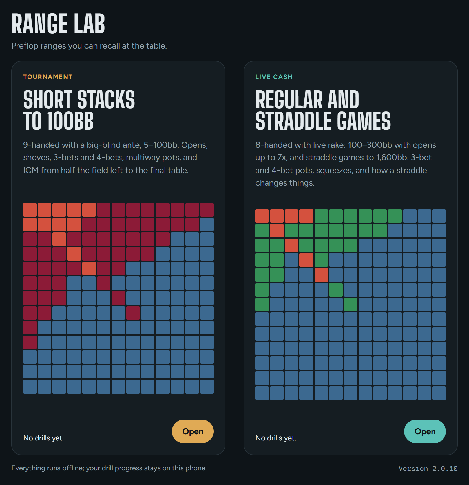
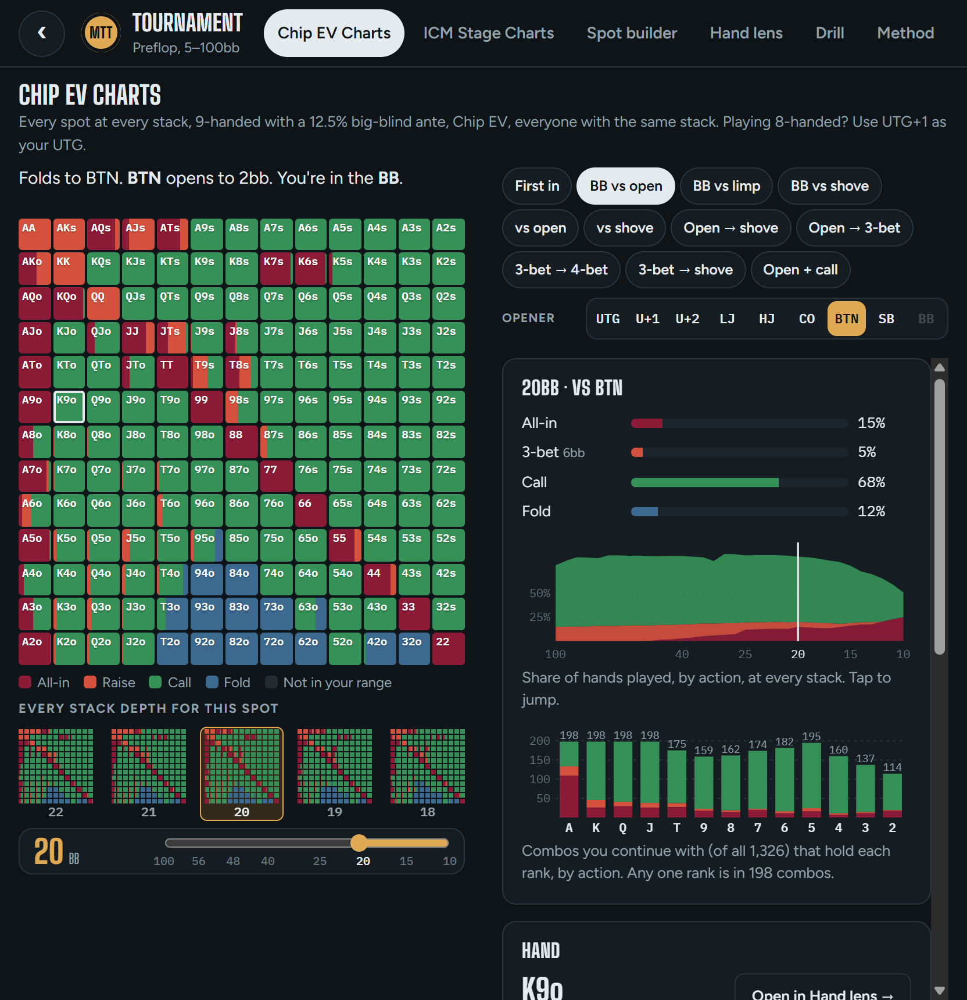
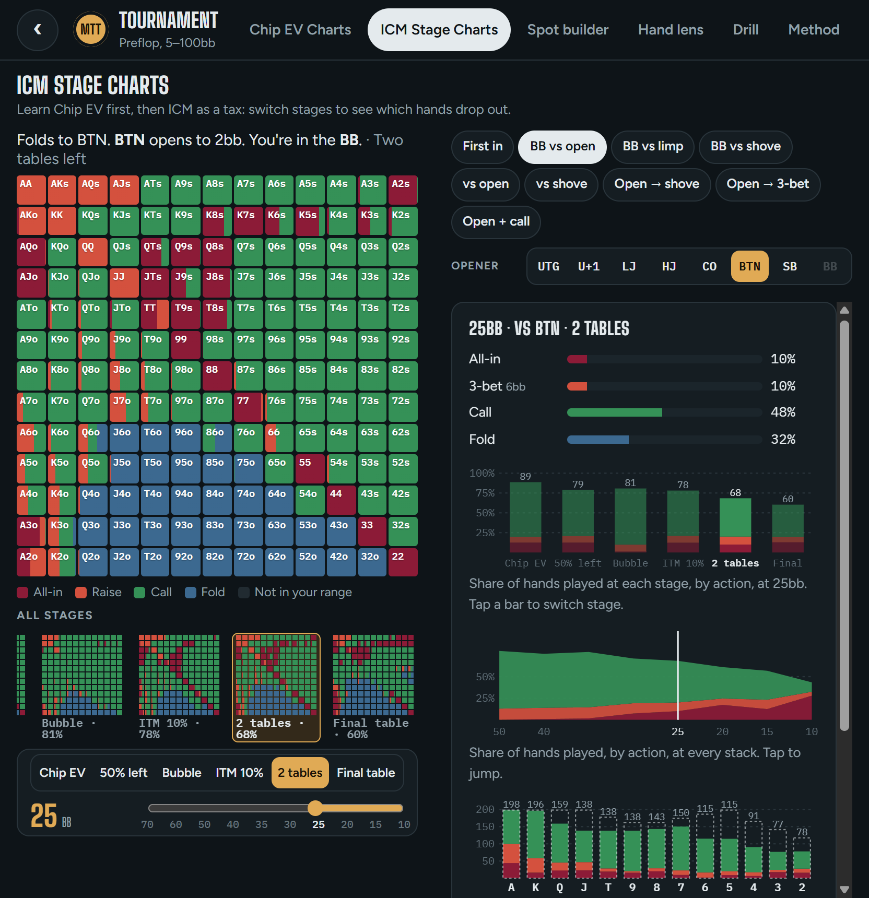
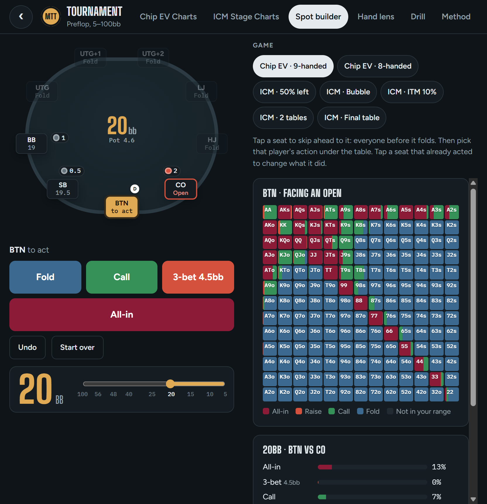
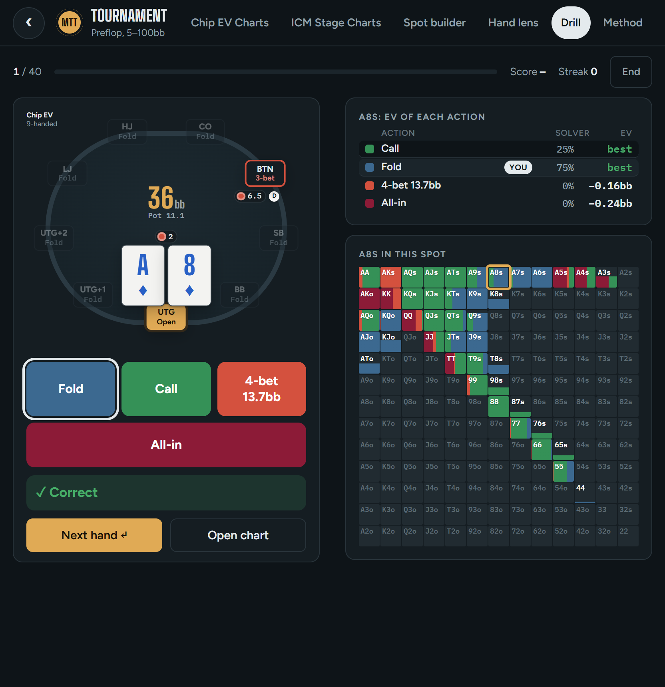
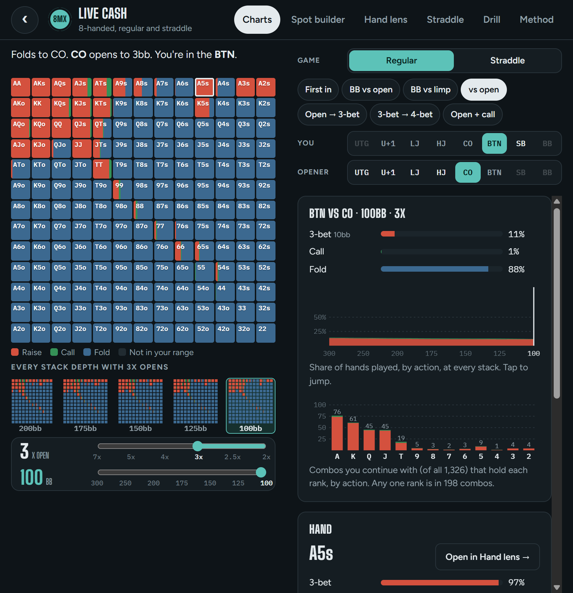

# Range Lab

Preflop range trainer for live poker, built from solver output. It's an Android app (made for the Galaxy Z Fold, unfolded) with two trainers:

- **Tournament**: 9-handed Chip EV, 12.5% ante, 5–100bb (38 depths, every seat matchup, 3-bet and 4-bet pots, multiway pots), plus 8-handed ICM stages (50% left, bubble, ITM 10%, 2 tables, final table).
- **Live cash**: 8-handed regular games (2x–7x opens, 100–300bb, 10% live rake) and single-straddle games (4–7bb opens, 50–1,600bb).

Each trainer has Charts (ranges by stack depth), a Spot builder (tap seats on a table to set up the action and see the range for whoever is to act), Hand lens (one hand across every spot and stack), and drills with spaced repetition. Quick fire shows each spot on a poker table.

## Screenshots

At the unfolded Galaxy Z Fold screen size (832 × 860), dark theme.

<table>
<tr>
<td width="50%"><br><sub><b>Home:</b> the two trainers.</sub></td>
<td width="50%"><br><sub><b>Chip EV Charts:</b> the big blind facing a button open at 20bb, and how that range changes from 100bb to 10bb.</sub></td>
</tr>
<tr>
<td width="50%"><br><sub><b>ICM Stage Charts:</b> the same spot at 25bb with two tables left, next to Chip EV, 50% left, the bubble, ITM 10% and the final table.</sub></td>
<td width="50%"><br><sub><b>Spot builder:</b> tap seats to set up the action; here the cutoff opens and the button is to act.</sub></td>
</tr>
<tr>
<td width="50%"><br><sub><b>Quick-fire drill:</b> answer at the table, then see what every action is worth.</sub></td>
<td width="50%"><br><sub><b>Live cash:</b> the button facing a cutoff 3x open at 100bb, with A5s tapped.</sub></td>
</tr>
</table>

## What's not in this repo

The range data is solver output from a personal subscription, so it isn't published here. These files are kept privately: `data.js`, `cash-data.js`, the built APK (it bundles the data), the signing keystore, and the crawler that pulls the data. The trainers need the two data files to show anything.

## Layout

| Path | What it is |
|---|---|
| `tournament-range-lab.html` | Tournament trainer page (loads `data.js`, `window.RANGE_DATA`) |
| `cash-range-lab.html` | Cash trainer page (loads `cash-data.js`, `window.CASH_DATA`) |
| `range-lab-app/web/` | App home screen, app stylesheet (two-pane layout at 600px+), app script |
| `range-lab-app/android/` | Manifest, WebView activity, icons |
| `range-lab-app/build.py` | Builds the APK without Gradle |
| `tools/` | Merge and audit scripts for the data files |
| `docs/screenshots/` | The screenshots above |

## Build the app

Needs JDK 21 and the Android SDK (platform 35, build-tools 35.0.0). The paths are at the top of `build.py`. Put `data.js` and `cash-data.js` next to the trainer pages and the keystore at `range-lab-app/android/rangelab.keystore`, then:

```bash
python range-lab-app/build.py
```

`build.py` wraps the two trainer pages as app pages (renaming them to "Tournament" and "Live cash"), copies the data, then runs aapt2 → javac → d8 → zipalign → apksigner and writes `range-lab-app/dist/RangeLab.apk`. Bump `versionCode` in `range-lab-app/android/AndroidManifest.xml` for each release. If there's no keystore, `build.py` creates a new one. An APK signed with a new key won't install over an existing install of the app.

## Data format

Merge new crawl output into the data files (new records win; every record is validated), then audit coverage:

```bash
python tools/merge_mtt.py data.js data.js ranges.json
python tools/merge_cash.py cash-data.js ranges.json cash-data.js
python tools/audit.py
```

Each record is `[family, tag, gametype, players, depth, hero, vs, caller, position, actions, freqs, evloss, reach, history]`, with hands in ASCII-sorted name order (`AA, AKo, AKs, …`). Cash records add the open size as a 15th field. Frequencies use 64 levels (`round(v*63)`), and EV loss is encoded as `round(9*ln(1+loss/0.02))`.
